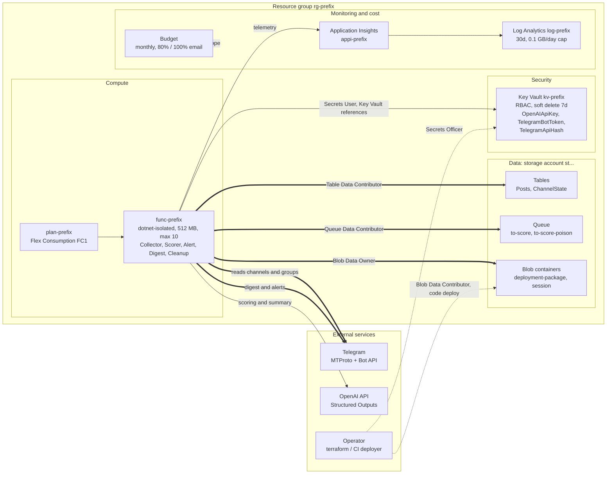

# Azure architecture: `rg-<name_prefix>`

Derived from the Terraform in `infra/` (read-only analysis, nothing was queried in a live subscription).
Names follow `<abbreviation>-${name_prefix}`; globally unique ones (`st`, `kv-`, `func-`) carry a 6-character hash suffix.
Region comes from `var.location`. Why it looks like this: [ADR-0002](adr/0002-host-on-flex-consumption.md), [ADR-0003](adr/0003-keep-secret-values-out-of-terraform-state.md).

## Summary

Everything lives in one resource group. The agent is a single .NET 10 isolated Function App on the Flex Consumption plan (`FC1`).
It keeps all state in one Storage Account (tables, a queue and blob containers) and reads its three secrets from Key Vault through App Settings references.

There are no keys or connection strings between resources: the Function App's system-assigned identity gets data-plane RBAC roles on Storage and Key Vault.
Telemetry goes to Application Insights backed by a capped Log Analytics workspace, and a monthly budget on the resource group emails at 80% and 100%.
There is no VNet or private endpoint on purpose (standing cost, $5 monthly budget).

## Resource inventory

| Resource | Name | Type | Key configuration |
|---|---|---|---|
| Resource group | `rg-<prefix>` | `azurerm_resource_group` | holds everything below |
| Service plan | `plan-<prefix>` | `azurerm_service_plan` | Linux, `FC1` (Flex Consumption) |
| Function App | `func-<prefix>-<hash>` | `azurerm_function_app_flex_consumption` | `dotnet-isolated`, 512 MB instances, max 10, system-assigned identity |
| Storage account | `st<prefix><hash>` | `azurerm_storage_account` | Standard LRS, TLS 1.2, no public blobs |
| Blob container | `deployment-package` | `azurerm_storage_container` | private, Flex Consumption code package |
| Blob container | `var.session_blob_container` | `azurerm_storage_container` | private, Telegram MTProto session |
| Table | `ChannelState` | `azurerm_storage_table` | per-source read cursors |
| Table | `Posts` | `azurerm_storage_table` | posts partitioned by day |
| Queue | `to-score` | `azurerm_storage_queue` | scoring work; poison queue `to-score-poison` is created by the runtime |
| Key Vault | `kv-<prefix>-<hash>` | `azurerm_key_vault` | standard, RBAC authorization, soft delete 7 days |
| Log Analytics | `log-<prefix>` | `azurerm_log_analytics_workspace` | PerGB2018, 30 days retention, 0.1 GB/day cap |
| Application Insights | `appi-<prefix>` | `azurerm_application_insights` | workspace-based |
| Budget | `budget-<prefix>` | `azurerm_consumption_budget_resource_group` | monthly, alerts at 80% and 100% |

Secrets in Key Vault (values are set by hand, never by Terraform): `OpenAIApiKey`, `TelegramBotToken`, `TelegramApiHash`.

## Diagram

## Relationship details

**Data flow.** The Collector timer reads sources over MTProto (session kept in a blob), writes posts to `Posts`, and queues batches in `to-score`.
The queue-triggered Scorer calls OpenAI and writes scores back. The Alert and Digest timers read `Posts` and send messages through the Bot API.
Cleanup deletes whole day partitions from `Posts`. See the README (How it works) for the full pipeline.

**Identity and RBAC** (`infra/roles.tf`).

| Principal | Scope | Role |
|---|---|---|
| Function App (system-assigned) | Storage account | Storage Blob Data Owner |
| Function App (system-assigned) | Storage account | Storage Queue Data Contributor |
| Function App (system-assigned) | Storage account | Storage Table Data Contributor |
| Function App (system-assigned) | Key Vault | Key Vault Secrets User |
| Deployer (`var.deployer_object_id`) | Key Vault | Key Vault Secrets Officer |
| Deployer (`var.deployer_object_id`) | Storage account | Storage Blob Data Contributor |

**Configuration.** `AzureWebJobsStorage__accountName` points the host at the storage account with identity auth (no connection string).
The three secrets are App Settings of the form `@Microsoft.KeyVault(SecretUri=.../secrets/<name>/)`. Schedules and sources are plain App Settings.

## Notes

- **No network isolation.** Storage and Key Vault are reachable over the public endpoint, protected by RBAC and TLS 1.2 only. Adding a VNet or private endpoints has a standing cost, so it needs an explicit decision.
- **Poison queue is unmonitored.** `to-score-poison` is not alerted on (see README, Known limitations).
- **Single region, LRS.** No redundancy for Storage; acceptable because posts are disposable and retention is short.
- **Blob Data Owner** for the function is required by Flex Consumption for the deployment container; it is broader than the table and queue roles.
- **Budget** is scoped to the resource group, so it does not cover OpenAI, which is the main real cost.
