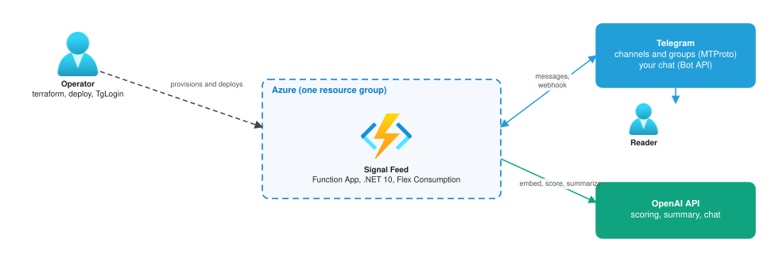

# Architecture

**Audience:** developers and reviewers who need the big picture before changing anything.
The user-facing behavior is in [How it works](../user-guide/how-it-works.md); the folders of the code are in [Code structure](code-structure.md).
The Azure parts are derived from the Terraform in `infra/` (nothing was queried in a live subscription).

## Overview

Signal Feed is a single .NET 10 (isolated worker) Azure Function App on the Flex Consumption plan.
Timers and queues drive a pipeline: collect Telegram posts, embed them and drop near-duplicates, score them with OpenAI and decide the alerts, send the alerts from a queue, then send a digest and alerts through the Telegram Bot API.
All state lives in one Storage Account, secrets in Key Vault, telemetry in Application Insights.
Resources talk to each other with managed identity and RBAC: there are no keys or connection strings between them.

## System context

## Runtime components

| Function | Trigger | Responsibility |
|---|---|---|
| `CollectorFunction` | `%CollectorSchedule%` | Reads new messages from the sources over MTProto, builds the group bundles, stores posts, queues them to `to-deduplicate` in batches of `ScoringBatchSize` |
| `DeduplicationFunction` | queue `to-deduplicate` | Embeds the new posts (`PostDeduplicator`, `text-embedding-3-small`, 512 dimensions, `PostVectors`), marks a single post that is at least `DuplicateSimilarityThreshold` alike to a single post published within `DuplicateWindowHours` (3) of it and already handled (inside one message, the earlier one is kept) as its duplicate (status `Scored`, no score, `DuplicateFinder`) and queues only the rest to `to-score`; the check and the save run one message at a time under the lease of `settings/locks/deduplication.lock` (the embedding call runs outside it, in parallel); when the embedding call fails the posts go on without vectors ([ADR-0023](../adr/0023-embed-posts-before-scoring-to-drop-duplicates-and-match-topics.md), [ADR-0024](../adr/0024-decide-alerts-where-posts-are-scored-and-send-them-from-a-queue.md)) |
| `ScorerFunction` | queue `to-score` | Scores posts with OpenAI (Structured Outputs) and writes Score, Topic, Reason, DuplicateOf (`ScoringStage`), then decides the alerts (`AlertDecider`, under the lease of `settings/locks/alert-decision.lock`): the important (`AlertThreshold`) or bursting (`BurstMinPosts`) posts of the groups in `AlertSources` outside their cooldown, and the posts of any source that match a followed topic (the post's vector against the topic's stored vector and `WatchSimilarityThreshold`, or the words, `WatchMatcher`); it marks them (`AlertedAt`, `WatchAlertedAt`) and publishes only them to `to-alert`, nothing during quiet hours ([ADR-0024](../adr/0024-decide-alerts-where-posts-are-scored-and-send-them-from-a-queue.md)) |
| `AlertSenderFunction` | queue `to-alert` | Sends a decided alert (`AlertSender`: `AlertMessage` for groups, `WatchAlertMessage` for followed topics) and marks its posts sent; it does not choose again |
| `FollowTopicFunction` | queue `topics-to-follow` | Starts following a topic that `SettingsEditor` saw added (`TopicFollower`): embeds it once, stores its vector in `settings/followed-topics.json` (vectors of removed topics stay there, unused) and has `AlertDecider` announce its matches among the posts of the last 26 hours |
| `DigestFunction` | `%DigestSchedule%` | Picks the best posts, asks the model for a summary and sends the digest (always) |
| `TelegramWebhookFunction` | HTTP `POST /api/telegram/webhook` (anonymous) | The bot's single entry point: checks the secret token header, parses the update and offers it to the handlers in order: pairing (binds the chat that sends `/start <TelegramPairingKey>`), then sign-in, the settings menu and the chat; the first that claims it wins ([ADR-0008](../adr/0008-bind-the-telegram-chat-with-a-pairing-key-over-a-webhook.md)) |
| `ChatFunction` | queue `chat-messages` | Answers one question about the latest digest with a Microsoft Agent Framework agent and tools ([ADR-0010](../adr/0010-chat-about-the-digest-with-one-conversation-blob.md)) |
| `LoginFunction` | queue `tg-login` | The waiting side of `/login`: holds the session lock and one MTProto connection, sends the Mini App buttons, takes the phone, the code and the SRP proof of the 2FA password (computed on the phone: the password never reaches us) from the attempt blob, replaces the session and announces the new account to every paired chat ([ADR-0016](../adr/0016-sign-in-to-telegram-from-the-bot-through-a-mini-app.md)) |
| `LoginPage`, `LoginSubmit` | HTTP `GET`/`POST /api/telegram/login` (anonymous) | The Mini App page and its form (phone, code, or the SRP proof the page computes from the 2FA password; `action: challenge` returns the public SRP values); the form is accepted only with `initData` signed by Telegram for this bot, from the paired chat that started the attempt, with its attempt id |
| `DailySummaryFunction` | `%DailySummarySchedule%` | Writes a summary of every finished day still in `Posts` (`DailySummaryJob`; one that fails queues nothing), then queues a `CleanupRequest` through yesterday |
| `CleanupFunction` | queue `cleanup-requests` | Runs every `ICleanupTask` (`CleanupRunner`): `PostsCleanup` deletes days older than `RetentionDays` from `Posts`, never past the last summarized day; `ChatStateCleanup` the stale conversations; `OldDailySummariesCleanup` the summaries older than `StatsRetentionDays`. A failure fails the run and the queue retries it |
| `DigestRequestFunction` | queue `digest-requests` | Writes the digest of a period asked with `/digest` (`OnDemandDigest`: the same summarizer and message as the daily digest, sent to the asking chat only, nothing marked as sent); never rethrows, so a message is not retried |
| `RunNowFunction` | queue `run-now` | Starts a job by name (`collect`, `digest`, `alert`, `daily-summary`) for testing, only when `ManualRunsEnabled` is true. The timer functions and this one call the same `IJob` class, so the logic exists once |

Blue lines go to Telegram, green lines to OpenAI, dashed lines are reads or side effects. Every diagram here is a draw.io file: open the `.drawio.svg` in [draw.io](https://app.diagrams.net), edit it and save it under the same name.

### Chat about the digest

The webhook only checks and queues, so Telegram gets its answer fast and does not resend. While the model writes, `ChatAgent` reads the answer as a stream and shows the text so far as a Telegram message draft (`sendMessageDraft`, first a placeholder «💭 Думаю», then the text so far once it has three words, updates at most every 0.7 s, plain text); a draft is a 30-second preview, so it is sent again every 20 s while the model thinks without writing (checked every 5 s), a text that came inside the 0.7 s window is not lost, a text over 4000 characters shows its end, and the real message replaces it. A draft has a short HTTP budget and no retry, and its failure turns the preview off but never fails or slows the answer (`ChatStreamEnabled` turns it off). `ChatProcessor` asks the model, saves the conversation with the blob ETag and only then sends the answer: a failed save never repeats a send.
Handled update ids are a set of the last 20 (not a watermark): messages run in parallel and Telegram may restart its ids. A new digest or a cleanup that replaces the blob makes a running turn drop its answer.
Text written by channels (the snapshot and tool results) reaches the model only inside a `<report>` or `<post>` block with `<` escaped.

#### Principles of the chat

- **One conversation per chat and per digest.** Every bound chat has its own blob; a new digest replaces it with a fresh snapshot, so there is no history of old digests ([ADR-0014](../adr/0014-serve-several-chats-with-shared-settings.md)). Settings and sources are shared by all chats, the conversation and the menu are not.
- **The conversation is ours, not OpenAI's.** The chat client uses the Responses API with `store=false` and encrypted reasoning, and we serialize the agent session ourselves ([ADR-0011](../adr/0011-call-the-chat-model-through-the-responses-api.md)).
- **The model sees the digest first.** The first message of a session is the snapshot of the digest; `ChatHistoryReducer` caps the history at `ChatMaxMessages` and never drops that first message or leaves a tool result without its call.
- **Tools are small and bounded.** `get_trends` reads the daily summaries and `get_commands` the bot's own command list (`BotCommands`); `get_post` and `search_posts` read stored posts (`ChatSearchMaxHits`; `search_posts` takes words and/or a period in the reader's `TimeZone`, `PostPeriod` clamps it to `RetentionDays` and to now; `ChatRequest.SentAt` (the Telegram message date) becomes a metadata message before the question (`ChatMetadata`)), the propose tools only build a plan, and the non-invasive tools (`rate_post`, `add_watch`, `remove_watch`, `clear_context`, `save_memory`, `forget_memory`) act at once. `offer_choices` only sets the turn's options: `ChatDelivery` sends them as a one-time reply keyboard (`ReplyKeyboard`) on the last part of the answer (an answer without them removes the keyboard), and a tap comes back as an ordinary text message, so no choice state is stored and no callback data limit applies. A turn is bounded by `ChatMaxToolCalls` and `ChatMaxOutputTokens`.
- **The model never makes an invasive change alone.** A change of settings, sources or prompts is a proposal shown by code and applied only by the owner's button ([ADR-0013](../adr/0013-let-the-chat-agent-propose-settings-changes-the-owner-confirms.md)); a non-invasive action (a vote, a followed topic, clearing the conversation, a note of the reader memory) is done at once ([ADR-0021](../adr/0021-let-the-chat-agent-do-non-invasive-actions-at-once.md)).
- **The reader memory is the agent's own.** Up to 10 short Markdown notes per chat that the agent writes and removes itself (`save_memory`, `forget_memory`, `Chat/Memory`); code builds each file (name `<yyyy-MM-dd>-<keywords>.md`, heading, keywords, date, one fact per line, at most 50 lines), every note goes into the instructions of every question inside `<reader_memory>` as data, and every change is told to the reader by a line under the answer built by code ([ADR-0022](../adr/0022-keep-a-reader-memory-the-chat-agent-manages-itself.md)).
- **Two projects.** `PostAgent.Core` holds the agent (features, contracts, adapters) and has no Azure Functions package; `PostAgent.Functions` holds the host and the thin `[Function]` entry points ([ADR-0020](../adr/0020-split-the-agent-into-core-and-functions-projects.md)).
- **Channel text is data.** It reaches the model only inside `<report>`, `<post>` or `<trends>` blocks (and, from the reader's votes, `<reader_feedback>` in scoring).

#### What the agent remembers

Only the blob `chat-state/<chat id>.json` is conversation memory; the other stores are the data the chat reads or the state around it. The model's context for a turn is rebuilt from the blob and is never stored as such.

Scoring is decoupled from collection by the queues (`to-deduplicate`, then `to-score`), and alerts are sent from `to-alert`, so a slow or failing model call never blocks reading Telegram, and failed messages retry and end in `to-score-poison` after 5 attempts.
Schedules are read through `%Name%` bindings, so they change without a rebuild.

## Data model

| Store | Name | Holds |
|---|---|---|
| Table | `Posts` | Posts and bundles, partitioned by day so cleanup deletes whole partitions; status, score, topic, reason, duplicate link, alert decision marks (`AlertedAt`, `WatchAlertedAt`), embedding (512 floats as bytes) |
| Table | `ChannelState` | Per-source read cursor (never cleaned up) |
| Table | `ChatBinding` | One row per paired chat (`chat`/`<chat id>`; an earlier version's `chat`/`digest` row still counts), at most `TelegramMaxChats`; deleted by the operator to unbind ([ADR-0014](../adr/0014-serve-several-chats-with-shared-settings.md)) |
| Queue | `to-deduplicate` (+ `to-deduplicate-poison`) | Collected posts for the deduplication stage (post references); made by Terraform like every trigger queue |
| Queue | `topics-to-follow` | A topic added to the followed ones (the phrase), published by `SettingsEditor` after the save; made by Terraform |
| Queue | `to-alert` (+ `to-alert-poison`) | A decided alert (`AlertRequest`: kind, post references, the topic each matched); made by Terraform |
| Queue | `to-score` (+ `to-score-poison`) | Work for the scorer; the poison queue is created by the runtime |
| Queue | `chat-messages` | Questions from the reader (`update_id`, text, id of the digest asked about, chat id); messages live one hour |
| Queue | `tg-login` | One message per `/login` (attempt id, chat id); lives 10 minutes, never retried |
| Queue | `digest-requests` | A `/digest` on its way to `DigestRequestFunction` (chat id, period in UTC); messages live 30 minutes; made by Terraform like every trigger queue |
| Queue | `cleanup-requests` | "The daily summaries are written through day D" (`CleanupRequest`), the only start of the cleanup; messages live a day; made by Terraform like every trigger queue |
| Queue | `run-now` | Job names to start on demand; whoever can write to it can run a job, so access is Azure RBAC plus the `ManualRunsEnabled` switch |
| Blob | `settings` / `overrides.json` | What the owner set from the bot (values, sources with a verified flag, alert sources, followed topics, edited prompt sections, the ids of the last handled menu updates); written with an ETag, read by `IEffectiveOptions` ([ADR-0012](../adr/0012-override-settings-from-the-telegram-bot-through-a-blob.md)) |
| Blob | `settings` / `stats/daily/<yyyy-MM-dd>.json` | The long memory ([ADR-0018](../adr/0018-keep-daily-summaries-as-long-memory.md)): counts, sources, topics and the five best posts of one finished UTC day, no post text; rewritten by `DailySummaryJob` on every run while the day is in `Posts` (a smaller summary never replaces a fuller one), deleted after `StatsRetentionDays`; read by `get_trends` and `/stats` |
| Blob | `settings` / `stats/usage.json` | Calls and tokens per UTC day and purpose (`scoring` for scoring and digest, `chat`), the latest 30 days, ETag writes; written by `UsageRecordingChatClient` below the function-calling layer, read by `/stats` |
| Blob | `settings` / `followed-topics.json` | The vector of every followed topic (phrase, 512 floats), written once per new topic by `FollowTopicFunction`, read by every alert decision ([ADR-0024](../adr/0024-decide-alerts-where-posts-are-scored-and-send-them-from-a-queue.md)) |
| Blob | `settings` / `locks/alert-decision.lock` | Empty; its lease lets one alert decision at a time read and mark the posts, so the cooldown of a group holds across parallel batches; waited for, up to 2 minutes |
| Blob | `settings` / `locks/deduplication.lock` | Empty; its lease (60 s, renewed every 20 s) lets one message of the deduplication stage at a time check duplicates and save vectors, on any instance ([ADR-0023](../adr/0023-embed-posts-before-scoring-to-drop-duplicates-and-match-topics.md)); a busy lock is waited for, up to 2 minutes |
| Blob | `settings` / `feedback.json` | The reader's likes and dislikes of posts (post id, source, topic, vote, time): the latest 40, one per post, shared by all chats; written by the agent's `rate_post` (ETag, 3 tries), read by the scorer, which puts it into every scoring request as `<reader_feedback>` (data, hint only) |
| Blob | `settings` / `reader-memory/<chat id>/<yyyy-MM-dd>-<keywords>.md` | The reader memory of one chat ([ADR-0022](../adr/0022-keep-a-reader-memory-the-chat-agent-manages-itself.md)): up to 10 Markdown notes about the reader, at most 50 lines each, written at once by the agent's `save_memory` / `forget_memory` (ETag), read into the chat instructions for every question; never cleaned. An old `profile/<chat id>.txt` ([ADR-0015](../adr/0015-edit-prompt-sections-and-a-reader-profile-from-the-chat.md)) becomes the first note on the first question and is deleted |
| Blob | `chat-state` / `<chat id>.json` | The conversation of one chat about the latest digest: snapshot of the digest (empty before the first digest, the chat works without it), ids of the last 20 handled updates, serialized agent session (dropped by `/clear`); overwritten by every digest |
| Blob | `var.session_blob_container` | Everything here is encrypted with the Key Vault key `tg-session` (envelope, AES-256-GCM, [ADR-0017](../adr/0017-encrypt-the-telegram-session-with-a-key-vault-key.md)) except `collect.lock`. The Telegram MTProto session, uploaded by `TgLogin` or by `/login`; `collect.lock`, leased for the length of a collection or a sign-in so that two of them never share the session (two connections on one auth key can make Telegram revoke it); `login-attempt.json`, the sign-in in progress (attempt id, chat, expiry, the public SRP challenge of the password step, and the phone, code and password proof the form sent until `LoginFunction` takes them; never the password), deleted when the sign-in ends |
| Blob | `deployment-package` | The code package of the Flex Consumption app |

Every storage name is defined once in `Shared/Infrastructure/StorageNames`.

## Azure resources

Everything lives in one resource group `rg-<prefix>`. Names follow `<abbreviation>-${name_prefix}`; globally unique ones (`st`, `kv-`, `func-`) carry a 6-character hash suffix.

| Resource | Name | Type | Key configuration |
|---|---|---|---|
| Service plan | `plan-<prefix>` | `azurerm_service_plan` | Linux, `FC1` (Flex Consumption) |
| Function App | `func-<prefix>-<hash>` | `azurerm_function_app_flex_consumption` | `dotnet-isolated`, 512 MB instances, max 10, system-assigned identity |
| Storage account | `st<prefix><hash>` | `azurerm_storage_account` | Standard LRS, TLS 1.2, no public blobs |
| Key Vault | `kv-<prefix>-<hash>` | `azurerm_key_vault` | standard, RBAC authorization, soft delete 7 days |
| Log Analytics | `log-<prefix>` | `azurerm_log_analytics_workspace` | PerGB2018, 30 days retention, 0.1 GB/day cap |
| Application Insights | `appi-<prefix>` | `azurerm_application_insights` | workspace-based |
| Budget | `budget-<prefix>` | `azurerm_consumption_budget_resource_group` | monthly, alerts at 80% and 100% |

Secrets in Key Vault (set by hand, never by Terraform): `OpenAIApiKey`, `TelegramBotToken`, `TelegramApiHash`, `TelegramPairingKey`, `TelegramWebhookSecret`.
Key in Key Vault (generated by Key Vault, created by Terraform): `tg-session`, RSA-3072, wrap and unwrap only; it encrypts the session and the sign-in in progress (`SessionKeyId`).
A rotation policy makes a new version every 90 days; each process wraps its data key with the current version, so rewritten blobs follow it.

The Azure icons come from draw.io's built-in `azure2` library.

## Identity and access

| Principal | Scope | Role |
|---|---|---|
| Function App (system-assigned) | Storage account | Storage Blob Data Owner |
| Function App (system-assigned) | Storage account | Storage Queue Data Contributor |
| Function App (system-assigned) | Storage account | Storage Table Data Contributor |
| Function App (system-assigned) | Key Vault | Key Vault Secrets User |
| Function App (system-assigned) | Key Vault key `tg-session` | Key Vault Crypto Service Encryption User (wrap and unwrap) |
| Deployer (`var.deployer_object_id`) | Key Vault | Key Vault Secrets Officer |
| Deployer (`var.deployer_object_id`) | Storage account | Storage Blob Data Contributor |
| Deployer (`var.deployer_object_id`) | Storage account | Storage Table Data Contributor (to edit `ChatBinding`) |
| Deployer (`var.deployer_object_id`) | Storage account | Storage Queue Data Contributor (to start a job with `tools/run-now.cs`) |
| Deployer (`var.deployer_object_id`) | Key Vault key `tg-session` | Key Vault Crypto Service Encryption User (`TgLogin` encrypts the session) |
| Whoever runs Terraform | Key Vault | Key Vault Crypto Officer (creates and rotates the `tg-session` key) |
| Whoever runs Terraform | Storage account | Storage Blob, Table and Queue Data Contributor (containers and queues through the data plane; skipped when it is the deployer, who holds them) |

The storage account keys are off (`shared_access_key_enabled = false`): nothing, not even Terraform, reaches storage with a key. Tables are created through the Resource Manager (`azapi_resource`, `local.tables`), because the `azurerm` provider reads table ACLs with a key ([ADR-0019](../adr/0019-keep-storage-keys-off-and-manage-tables-through-arm.md)).

`AzureWebJobsStorage__accountName` points the host at the storage account with identity authentication. When it is set it wins over any `AzureWebJobsStorage` connection string; the connection string is the local-development path. The secrets are App Settings of the form
`@Microsoft.KeyVault(SecretUri=.../secrets/<name>/)`. Roles are defined in `infra/roles.tf`.

## Design decisions

| Decision | Why | Record |
|---|---|---|
| Host on Flex Consumption | Idle most of the time, so pay-per-use fits the $5 budget; Premium and Dedicated plans cost far more | [ADR-0002](../adr/0002-host-on-flex-consumption.md) |
| Secret values never in Terraform state | Terraform state is plain text and read by the pipeline identity; Key Vault references keep values out of it | [ADR-0003](../adr/0003-keep-secret-values-out-of-terraform-state.md) |
| Terraform runs from a manual workflow | Changes are rare and can be destructive: plan first, apply on request, with a plan visible in the run summary | [ADR-0004](../adr/0004-run-terraform-from-a-manual-workflow.md) |
| Every deploy is a release with a build-counter version | Traceable versions and simple rollback | [ADR-0005](../adr/0005-release-every-deploy-with-a-build-counter-version.md) |
| Bind the chat with a pairing key over a webhook | The operator does not have to look up a chat id; the first chat with the secret key wins and the id is stored in a table | [ADR-0008](../adr/0008-bind-the-telegram-chat-with-a-pairing-key-over-a-webhook.md) |
| Chat about the digest with one conversation blob | A new digest replaces the state, so nothing accumulates; the queue keeps the webhook fast; the agent framework core gives session serialization without durable hosting | [ADR-0010](../adr/0010-chat-about-the-digest-with-one-conversation-blob.md) |
| Sign in to Telegram from the bot through a Mini App | The session can be renewed from the phone; the code never travels as a Telegram message, and the 2FA password never leaves the phone (SRP proof computed in the page) | [ADR-0016](../adr/0016-sign-in-to-telegram-from-the-bot-through-a-mini-app.md) |
| Encrypt the Telegram session with a Key Vault key | Storage access alone (a key, a SAS, a backup) shows only ciphertext; Key Vault is called about once per process | [ADR-0017](../adr/0017-encrypt-the-telegram-session-with-a-key-vault-key.md) |
| Keep the storage keys off, tables through the Resource Manager | A leaked key would open every blob, table and queue; `azurerm` cannot manage tables without one, `azapi` can | [ADR-0019](../adr/0019-keep-storage-keys-off-and-manage-tables-through-arm.md) |
| Keep a small summary per day as the long memory | Trends and `/stats` for months without keeping post text | [ADR-0018](../adr/0018-keep-daily-summaries-as-long-memory.md) |
| Decide alerts where posts are scored, send them from a queue | An alert comes minutes after scoring instead of up to an hour later; each stage has one job and a queue carries only work its consumer serves | [ADR-0024](../adr/0024-decide-alerts-where-posts-are-scored-and-send-them-from-a-queue.md) |
| Embed posts before scoring | Duplicates across channels and runs cost no scoring tokens, and followed topics match by meaning; a failed embedding never holds scoring back | [ADR-0023](../adr/0023-embed-posts-before-scoring-to-drop-duplicates-and-match-topics.md) |
| Keep a reader memory the chat agent manages itself | A profile behind a confirmation stayed empty; short structured notes the agent keeps, each change shown under the answer | [ADR-0022](../adr/0022-keep-a-reader-memory-the-chat-agent-manages-itself.md) |
| Fix formatting and validate Terraform in the build job | One pipeline gates the deploy: a broken format or Terraform change cannot reach it | [ADR-0006](../adr/0006-fix-formatting-and-validate-terraform-in-the-build-job.md) |

## Known gaps

- **The webhook endpoint is public.** It is protected by the secret token header and the pairing key, not by a function key (Telegram cannot send one).
- **The sign-in page is public.** Its form trusts only `initData` signed with the bot token, so a leaked bot token also lets someone submit a form; they still need the login code Telegram sends to the reader account. Any paired chat can sign the reader in as another account it controls; every paired chat is told which account reads the channels after each sign-in.
- **A login code passes through storage.** It sits in `login-attempt.json`, encrypted with the session key, for the seconds between the form and `LoginFunction` (which clears it at once); it is single-use.
- **The session key protects against storage-only access, not against the function.** The function and the deployer can both read the blobs and unwrap the key. The 2FA password never reaches the app: only its single-use SRP proof does.
- **The chat costs money per question and has no per-day limit.** Only the bound private chat reaches it, and a conversation, a reply and the tool calls per question are capped, but there is no daily budget for questions; a question costs up to `ChatMaxToolCalls + 1` model calls.
- **No network isolation.** Storage and Key Vault are reachable over their public endpoints, protected by RBAC and TLS 1.2. A VNet or private endpoints have a standing cost, so they need an explicit decision.
- **Anyone with write access to the `run-now` queue can start a job** (the function identity and the deployer; storage keys are not disabled either). The switch `ManualRunsEnabled` is off in Azure by default, so a message does nothing until the operator turns it on.
- **The poison queue is not monitored.** No Azure alert fires on `to-score-poison`, `to-deduplicate-poison` or `to-alert-poison`; the digest only reports how many posts are left unscored («⚠️ Не оцінено N постів»).
- **Single region, LRS.** Acceptable because posts are disposable and retention is short.
- **Blob Data Owner** for the function is required by Flex Consumption for the deployment container and is broader than the table and queue roles.
- **The budget covers Azure only,** not OpenAI, which is the main real cost.

User-visible limitations are in [troubleshooting](../user-guide/troubleshooting.md#known-limitations).
