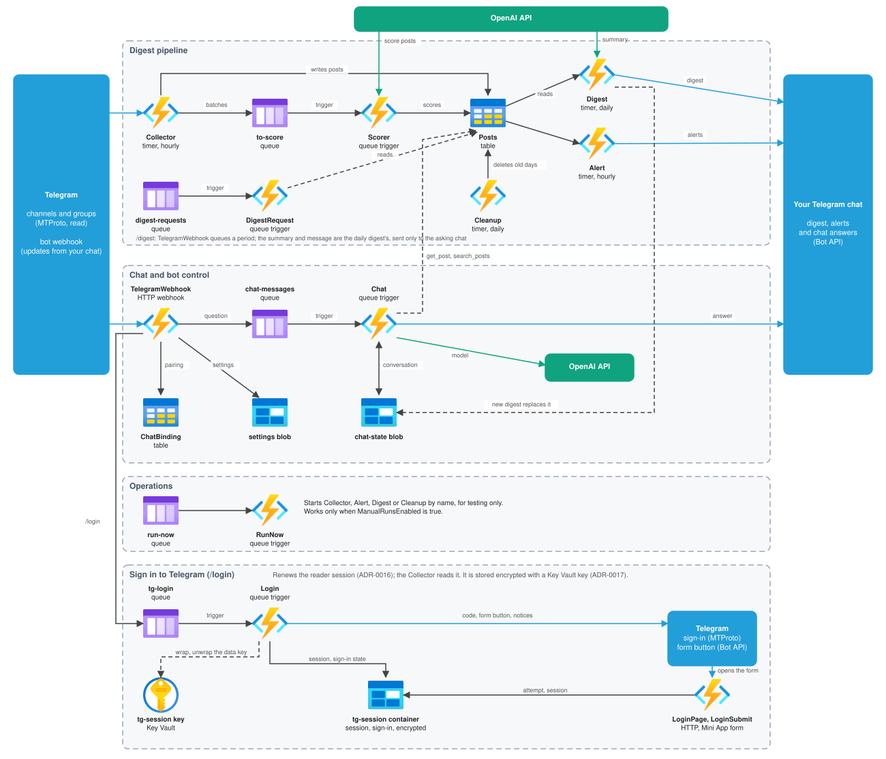
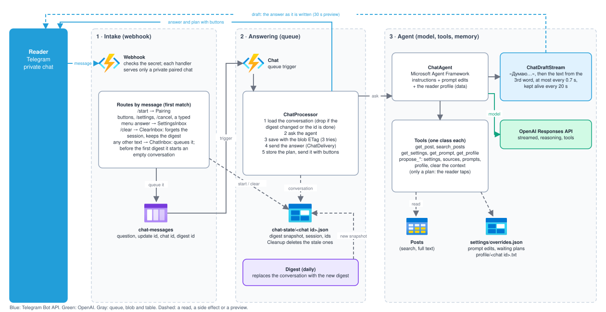
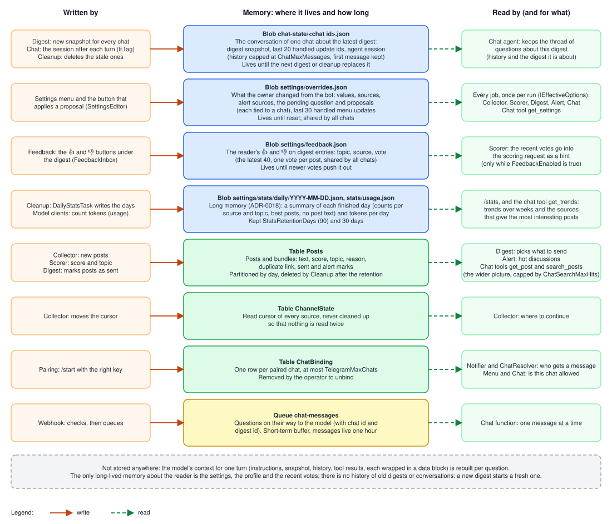
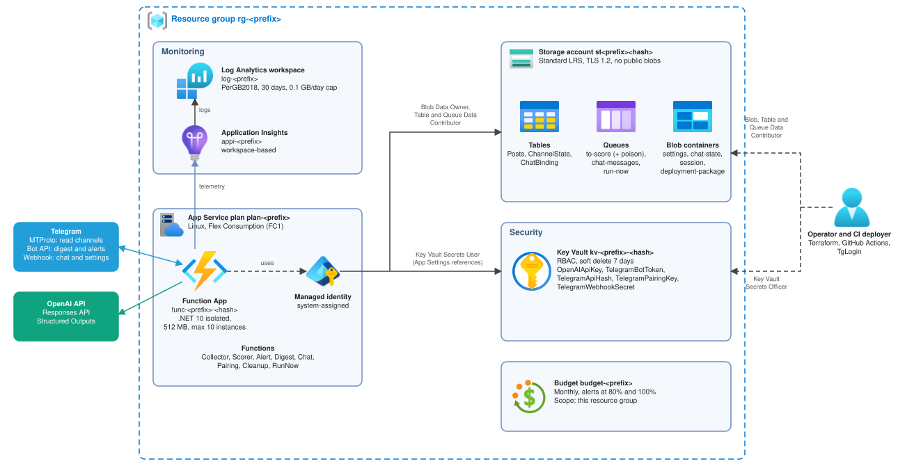

# Architecture

**Audience:** developers and reviewers who need the big picture before changing anything.
The user-facing behavior is in [How it works](../user-guide/how-it-works.md); the folders of the code are in [Code structure](code-structure.md).
The Azure parts are derived from the Terraform in `infra/` (nothing was queried in a live subscription).

## Overview

Signal Feed is a single .NET 10 (isolated worker) Azure Function App on the Flex Consumption plan.
Timers drive a pipeline: collect Telegram posts, score them with OpenAI through a queue, then send a digest and alerts through the Telegram Bot API.
All state lives in one Storage Account, secrets in Key Vault, telemetry in Application Insights.
Resources talk to each other with managed identity and RBAC: there are no keys or connection strings between them.

## System context

## Runtime components

| Function | Trigger | Responsibility |
|---|---|---|
| `CollectorFunction` | `%CollectorSchedule%` | Reads new messages from the sources over MTProto, stores posts, queues them in batches of `ScoringBatchSize` |
| `ScorerFunction` | queue `to-score` | Scores posts with OpenAI (Structured Outputs) and writes Score, Topic, Reason, DuplicateOf |
| `AlertFunction` | `%AlertSchedule%` | Sends an alert about a burst or a very important message in the groups of `AlertSources` |
| `DigestFunction` | `%DigestSchedule%` | Picks the best posts, asks the model for a summary and sends the digest (always) |
| `PairingFunction` | HTTP `POST /api/telegram/webhook` (anonymous) | The bot's webhook: checks the secret token header, binds the chat that sends `/start <TelegramPairingKey>`, and hands every other update (a message or a button press) to the handlers, the settings menu first and then the chat ([ADR-0008](../adr/0008-bind-the-telegram-chat-with-a-pairing-key-over-a-webhook.md)) |
| `ChatFunction` | queue `chat-messages` | Answers one question about the latest digest with a Microsoft Agent Framework agent and tools ([ADR-0010](../adr/0010-chat-about-the-digest-with-one-conversation-blob.md)) |
| `CleanupFunction` | `%CleanupSchedule%` | Runs every `ICleanupTask`; today it deletes days older than `RetentionDays` from `Posts` |
| `RunNowFunction` | queue `run-now` | Starts a job by name (`collect`, `digest`, `alert`, `cleanup`) for testing, only when `ManualRunsEnabled` is true. The timer functions and this one call the same `IJob` class, so the logic exists once |

Blue lines go to Telegram, green lines to OpenAI, dashed lines are reads or side effects. Every diagram here is a draw.io file: open the `.drawio.svg` in [draw.io](https://app.diagrams.net), edit it and save it under the same name.

### Chat about the digest

The webhook only checks and queues, so Telegram gets its answer fast and does not resend. `ChatProcessor` asks the model, saves the conversation with the blob ETag and only then sends the answer: a failed save never repeats a send.
Handled update ids are a set of the last 20 (not a watermark): messages run in parallel and Telegram may restart its ids. A new digest or a cleanup that replaces the blob makes a running turn drop its answer.
Text written by channels (the snapshot and tool results) reaches the model only inside a `<report>` or `<post>` block with `<` escaped.

#### Principles of the chat

- **One conversation per chat and per digest.** Every bound chat has its own blob; a new digest replaces it with a fresh snapshot, so there is no history of old digests ([ADR-0014](../adr/0014-serve-several-chats-with-shared-settings.md)). Settings and sources are shared by all chats, the conversation and the menu are not.
- **The conversation is ours, not OpenAI's.** The chat client uses the Responses API with `store=false` and encrypted reasoning, and we serialize the agent session ourselves ([ADR-0011](../adr/0011-call-the-chat-model-through-the-responses-api.md)).
- **The model sees the digest first.** The first message of a session is the snapshot of the digest; `ChatHistoryReducer` caps the history at `ChatMaxMessages` and never drops that first message or leaves a tool result without its call.
- **Tools are small and bounded.** `get_post` and `search_posts` read stored posts (`ChatSearchMaxHits`), the settings tools only build a plan. A turn is bounded by `ChatMaxToolCalls` and `ChatMaxOutputTokens`.
- **The model never changes anything alone.** A settings change is a proposal shown by code and applied only by the owner's button ([ADR-0013](../adr/0013-let-the-chat-agent-propose-settings-changes-the-owner-confirms.md)).
- **Channel text is data.** It reaches the model only inside `<report>` or `<post>` blocks.

#### What the agent remembers

Only the blob `chat-state/<chat id>.json` is conversation memory; the other stores are the data the chat reads or the state around it. The model's context for a turn is rebuilt from the blob and is never stored as such.

Scoring is decoupled from collection by the queue, so a slow or failing model call never blocks reading Telegram, and failed messages retry and end in `to-score-poison` after 5 attempts.
Schedules are read through `%Name%` bindings, so they change without a rebuild.

## Data model

| Store | Name | Holds |
|---|---|---|
| Table | `Posts` | Posts and bundles, partitioned by day so cleanup deletes whole partitions; status, score, topic, reason, duplicate link, alert mark |
| Table | `ChannelState` | Per-source read cursor (never cleaned up) |
| Table | `ChatBinding` | One row per paired chat (`chat`/`<chat id>`; an earlier version's `chat`/`digest` row still counts), at most `TelegramMaxChats`; deleted by the operator to unbind ([ADR-0014](../adr/0014-serve-several-chats-with-shared-settings.md)) |
| Queue | `to-score` (+ `to-score-poison`) | Work for the scorer; the poison queue is created by the runtime |
| Queue | `chat-messages` | Questions from the reader (`update_id`, text, id of the digest asked about, chat id); messages live one hour |
| Queue | `run-now` | Job names to start on demand; whoever can write to it can run a job, so access is Azure RBAC plus the `ManualRunsEnabled` switch |
| Blob | `settings` / `overrides.json` | What the owner set from the bot (values, sources with a verified flag, alert sources, edited prompt sections, the ids of the last handled menu updates); written with an ETag, read by `IEffectiveOptions` ([ADR-0012](../adr/0012-override-settings-from-the-telegram-bot-through-a-blob.md)) |
| Blob | `settings` / `profile/<chat id>.txt` | What the reader of one chat wrote about themselves, plain text, one blob per chat; the chat adds it to its instructions as data; written by the chat through a confirmed edit ([ADR-0015](../adr/0015-edit-prompt-sections-and-a-reader-profile-from-the-chat.md)) |
| Blob | `chat-state` / `<chat id>.json` | The conversation of one chat about the latest digest: snapshot of the digest, ids of the last 20 handled updates, serialized agent session; overwritten by every digest |
| Blob | `var.session_blob_container` | The Telegram MTProto session, uploaded by `TgLogin`, and `collect.lock`, leased for the length of a collection so that two collections never share the session (two connections on one auth key can make Telegram revoke it) |
| Blob | `deployment-package` | The code package of the Flex Consumption app |

Every storage name is defined once in `Shared/Infrastructure/StorageNames`.

## Azure resources

Everything lives in one resource group `rg-<prefix>`. Names follow `<abbreviation>-${name_prefix}`; globally unique ones (`st`, `kv-`, `func-`) carry a 6-character hash suffix.

| Resource | Name | Type | Key configuration |
|---|---|---|---|
| Service plan | `plan-<prefix>` | `azurerm_service_plan` | Linux, `FC1` (Flex Consumption) |
| Function App | `func-<prefix>-<hash>` | `azurerm_function_app_flex_consumption` | `dotnet-isolated`, 512 MB instances, max 10, system-assigned identity |
| Storage account | `st<prefix><hash>` | `azurerm_storage_account` | Standard LRS, TLS 1.2, no public blobs |
| Key Vault | `kv-<prefix>-<hash>` | `azurerm_key_vault` | standard, RBAC authorization, soft delete 7 days |
| Log Analytics | `log-<prefix>` | `azurerm_log_analytics_workspace` | PerGB2018, 30 days retention, 0.1 GB/day cap |
| Application Insights | `appi-<prefix>` | `azurerm_application_insights` | workspace-based |
| Budget | `budget-<prefix>` | `azurerm_consumption_budget_resource_group` | monthly, alerts at 80% and 100% |

Secrets in Key Vault (set by hand, never by Terraform): `OpenAIApiKey`, `TelegramBotToken`, `TelegramApiHash`, `TelegramPairingKey`, `TelegramWebhookSecret`.

The Azure icons come from draw.io's built-in `azure2` library.

## Identity and access

| Principal | Scope | Role |
|---|---|---|
| Function App (system-assigned) | Storage account | Storage Blob Data Owner |
| Function App (system-assigned) | Storage account | Storage Queue Data Contributor |
| Function App (system-assigned) | Storage account | Storage Table Data Contributor |
| Function App (system-assigned) | Key Vault | Key Vault Secrets User |
| Deployer (`var.deployer_object_id`) | Key Vault | Key Vault Secrets Officer |
| Deployer (`var.deployer_object_id`) | Storage account | Storage Blob Data Contributor |
| Deployer (`var.deployer_object_id`) | Storage account | Storage Table Data Contributor (to edit `ChatBinding`) |
| Deployer (`var.deployer_object_id`) | Storage account | Storage Queue Data Contributor (to start a job with `tools/run-now.cs`) |

`AzureWebJobsStorage__accountName` points the host at the storage account with identity authentication. The secrets are App Settings of the form
`@Microsoft.KeyVault(SecretUri=.../secrets/<name>/)`. Roles are defined in `infra/roles.tf`.

## Design decisions

| Decision | Why | Record |
|---|---|---|
| Host on Flex Consumption | Idle most of the time, so pay-per-use fits the $5 budget; Premium and Dedicated plans cost far more | [ADR-0002](../adr/0002-host-on-flex-consumption.md) |
| Secret values never in Terraform state | Terraform state is plain text and read by the pipeline identity; Key Vault references keep values out of it | [ADR-0003](../adr/0003-keep-secret-values-out-of-terraform-state.md) |
| Terraform runs from a manual workflow | Changes are rare and can be destructive: plan first, apply on request, with a plan visible in the run summary | [ADR-0004](../adr/0004-run-terraform-from-a-manual-workflow.md) |
| Every deploy is a release with a build-counter version | Traceable versions and simple rollback | [ADR-0005](../adr/0005-release-every-deploy-with-a-build-counter-version.md) |
| Bind the chat with a pairing key over a webhook | The operator does not have to look up a chat id; the first chat with the secret key wins and the id is stored in a table | [ADR-0008](../adr/0008-bind-the-telegram-chat-with-a-pairing-key-over-a-webhook.md) |
| Chat about the digest with one conversation blob | A new digest replaces the state, so nothing accumulates; the queue keeps the webhook fast; the agent framework core gives session serialization without durable hosting | [ADR-0010](../adr/0010-chat-about-the-digest-with-one-conversation-blob.md) |
| Fix formatting and validate Terraform in the build job | One pipeline gates the deploy: a broken format or Terraform change cannot reach it | [ADR-0006](../adr/0006-fix-formatting-and-validate-terraform-in-the-build-job.md) |

## Known gaps

- **The webhook endpoint is public.** It is protected by the secret token header and the pairing key, not by a function key (Telegram cannot send one).
- **The chat costs money per question and has no per-day limit.** Only the bound private chat reaches it, and a conversation, a reply and the tool calls per question are capped, but there is no daily budget for questions; a question costs up to `ChatMaxToolCalls + 1` model calls.
- **No network isolation.** Storage and Key Vault are reachable over their public endpoints, protected by RBAC and TLS 1.2. A VNet or private endpoints have a standing cost, so they need an explicit decision.
- **Anyone with write access to the `run-now` queue can start a job** (the function identity and the deployer; storage keys are not disabled either). The switch `ManualRunsEnabled` is off in Azure by default, so a message does nothing until the operator turns it on.
- **The poison queue is not monitored.** No Azure alert fires on `to-score-poison`; the digest only reports how many posts are left unscored («⚠️ Не оцінено N постів»).
- **Single region, LRS.** Acceptable because posts are disposable and retention is short.
- **Blob Data Owner** for the function is required by Flex Consumption for the deployment container and is broader than the table and queue roles.
- **The budget covers Azure only,** not OpenAI, which is the main real cost.

User-visible limitations are in [troubleshooting](../user-guide/troubleshooting.md#known-limitations).
