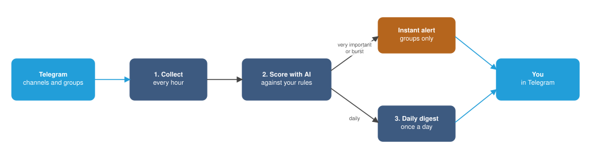

# How it works

**Audience:** operators who want to understand why the agent behaves the way it does, before tuning it.
Setting names (in `code`) are explained in [Configuration](configuration.md). The technical view is in the [architecture](../developer-guide/architecture.md).

## The life of a post

1. **Collect.** Every hour the agent reads new messages from your sources. The first time it sees a source, it reads the last 24 hours.
2. **Drop repeats.** Each post gets an embedding (a list of numbers that stands for its meaning). A single post that says almost the same as another post that was already handled,
   from any channel and published within 3 hours of it (`DuplicateWindowHours`), is marked as its duplicate and is not scored, so the model does not pay for it twice. Group bundles are never treated as duplicates. If the embedding fails, the posts go on to scoring as before.
3. **Score.** Each post gets a score, a topic and a short reason from the AI model, judged against your rules in [`prompts/scoring.md`](../../prompts/scoring.md). Near-duplicates are recognized.
4. **Deliver.** Right after scoring the agent decides whether a post deserves an alert, and the alert goes out at once, so it comes within about an hour of publication (the collection interval). Once a day the best of the rest become the digest.

A daily summary of the finished days is written first, and then a cleanup removes old posts, so storage stays small and nothing is deleted before its summary is saved.

## Channels and groups

**Channels.** Every post is scored on its own.

**Groups** are noisy, so they are handled differently:

- If only a few messages arrived since the last run (up to `MaxItemsPerGroup`, 5 by default), each is a separate post.
- If there are more, messages are split by time into at most `MaxItemsPerGroup` bundles of similar size, and each bundle is scored with one AI call.
  The busier the group, the bigger the bundle, but the cost does not grow.
- Inside a bundle the messages with the most reactions, forwards and replies come first, so the key ones are not lost.
- The minimum length `MinPostChars` applies to single messages only. Short replies stay in a bundle, because their number shows a burst.

## Alerts

- The decision is made right after a post is scored, and the alert is sent at once ([ADR-0024](../adr/0024-decide-alerts-where-posts-are-scored-and-send-them-from-a-queue.md)).
- Only for groups listed in `AlertSources`. Channels never trigger alerts.
- An alert is sent when a message or bundle scores at least `AlertThreshold` (9), or a bundle has at least `BurstMinPosts` (8) messages.
- One group triggers at most one alert per `AlertCooldownHours` (3), and one alert holds at most `AlertMaxPerRun` (3) entries (the posts scored together).
- During `AlertQuietHours` (for example `23:00-07:00`) no alert is decided, and those posts go into the digest instead; they are not sent after the quiet hours either.
- A post that already triggered an alert is not repeated in the digest.

### Followed topics

Tell the agent «стеж за google core update» (or «перестань стежити за ...», «за чим я стежу?»). It does it at once, no button needed (following a topic is not invasive). From then on a **new scored post from any source** (channels too) that is about the topic is sent as its own message «👀 Стеження за темою» with the topic it matched, whatever its score and without the cooldown of its source.
A post is about the topic when its meaning is close enough to the phrase (`WatchSimilarityThreshold`), so «google core update» also finds «Google оновив основний алгоритм» and a Ukrainian phrase finds an English post,
or when it has every word of the phrase (any order and case, each word must start a word of the post, «core» does not match «score», and a word of up to three letters such as «ai» must stand alone).

- The phrase is embedded once, when it is added, and its vector is kept; a post is compared with it right after the post is scored, and the message comes at once. A post without an embedding, or a topic whose vector is not there yet, is matched by the words only.
- Adding a topic also announces its matches of the last 26 hours that nobody announced yet (within a minute).
- At most 5 posts in one message, best first; a match beyond that, or one found during quiet hours, goes into the digest.
- A post is announced once: it is marked as sent, so the digest does not repeat it. A duplicate of another post is skipped.
- At most 20 topics of up to 100 characters. «Скинути все» in `/settings` returns the topics to the `Watches` App Setting; resetting only the Alerts group leaves them (remove a topic by asking the agent).

## The digest

After the best posts are chosen (`DigestSize`, 7 by default), one more AI call writes the digest, using [`prompts/digest.md`](../../prompts/digest.md).
It arrives in sections (a section with nothing in it is left out):

- **🔥 Головне за день**: the most important news with the point and why it matters.
- **💼 Корисно для Collaborator**: what can affect the catalog, demand or the marketplace.
- **👀 Варто звернути увагу**: less obvious cases, tools, studies and opinions.
- **📖 Рекомендую прочитати**: up to three posts worth reading in full.
- **⚠️ Потребує перевірки**: claims to check before relying on them.
- **📌 Можна пропустити**: how many posts were left out (near-duplicates, also those that were never scored, and less important ones).

The model never writes links, channels or dates: the agent adds them from the post data, so they cannot be invented. A long digest is split into several Telegram messages,
and a section that continues in the next message repeats its header.

If OpenAI is unavailable or its answer is invalid (including an answer that names none of the selected posts), the digest still arrives, as a plain list of the posts with the short scoring reasons.
The digest is always sent, even when nothing stood out.

Posts that are still unscored two hours after they were published (scoring failed, see [troubleshooting](troubleshooting.md)) cannot be in the digest.
The digest then adds a separate message «⚠️ Не оцінено N постів», and sends it instead of «За добу нових постів не було» when nothing was scored, so a broken OpenAI key does not look like a quiet day.

## A digest on demand

Send `/digest` to the bot in the private chat to get a digest of any period outside the schedule. The posts are the best scored ones of the period, also those a daily digest already sent, and the digest is written like the daily one but goes only to the chat that asked:

- `/digest`: the last 24 hours; `/digest 6`: the last 6 hours; `/digest today`, `/digest вчора` (the day in your `TimeZone`);
- `/digest 2026-11-25T18:00 2026-11-25T23:00`: an exact period (a date without a time is the whole day; use `T`, no spaces inside a value).

An unreadable period gets this help back. Posts are kept for `RetentionDays` (2 by default), so an older period is empty. A request costs one model call, like the daily digest; it marks nothing as sent and does not replace the conversation, so the chat keeps talking about the daily digest. Its posts can be rated like the daily ones ([rating](#rating-posts)). The reply «⏳ Готую дайджест…» comes at once, the digest follows within a minute.

## Statistics and trends

Send `/stats` (or `/stats 30`) for numbers: how many posts were collected, scored and found interesting, which sources give the most interesting posts (and which the least), the most frequent topics, and the tokens the models used (scoring and digest, chat). It needs no model call and answers at once.
The numbers come from a small summary of every finished day (counts per source and topic, the best posts, no post text), written by the daily summary job at about 03:00 UTC (`DailySummarySchedule`), which then asks the cleanup to delete the old posts, and kept for `StatsRetentionDays` (90 by default). Ask the agent for the same over time: «що змінилось за місяць у темі google core update?», «як змінилась кількість постів про AI-пошук за тижні?».
The summaries have no text, so the agent cannot quote an old post from them; for a recent one it uses the stored posts. A day has a summary only after it ends; `/stats` summarizes the days still stored on the spot. Days are UTC dates.

## What the bot can do

Ask the agent «що ти вмієш?» or «які є команди?»: it lists them from the bot's own list. They are `/settings`, `/digest [period]`, `/stats [days]`, `/clear`, `/login`, `/start <key>`; everything else you simply ask the agent.

## Rating posts

Tell the agent what you think of a news item: reply to it (or quote it) with «👍», «+», «лайк», «цікаво», «більше такого», or «👎», «-», «мінус», «не цікаво». You can also just write «лайк новині про Serpstat». The agent finds the post (in the digest, or among the stored posts for a `/digest` or an older one), saves the vote at once and says so; if it is not clear which post you mean, it asks. Rate again to change your mind.
The latest 40 votes (one per post, shared by all chats) go into every scoring request as a hint about your taste: a post clearly about a topic you liked may get one point more, about one you disliked one point less, and never against the scoring rules.
The votes have no effect on posts that are already scored. Posts are kept for `RetentionDays`, so an older one can no longer be rated. Switch rating and the hint off with `FeedbackEnabled` ([configuration](configuration.md#settings)).

## Asking about the digest

Write to the bot in the private chat to ask more (after a digest, or before the first one): «розкажи детальніше про пункт 3», «що з цього важливе для каталогу?». The agent can also show and change parts of its own prompts, each change only after you confirm the exact before and after ([configuration](configuration.md#prompts-from-the-chat)), and it keeps short notes about you by itself, telling you under the answer what it saved or forgot ([reader memory](configuration.md#reader-memory)). You can also use Telegram's reply or quote on any message: the quoted part (or the message you replied to) goes to the model with your question, so «розкрий цю тему» knows which topic you mean.
An AI assistant answers in Ukrainian, plain text, using the digest you received. If the digest is not enough, it can open the full text of a post and
search the posts stored for the last `RetentionDays` days, by words, by day or by time of publication (for example «що ще писали про це вчора?» or «що вийшло сьогодні між 9 і 12?»; times are in your time zone, the `TimeZone` setting). A question the posts do not cover is answered from the model's own knowledge,
and the answer says so. It does not browse the web.

- **What the agent does at once, and what it asks you to confirm.** Non-invasive actions are done at once: rating a post, following or unfollowing a topic, clearing the conversation, and keeping the notes about you. Changes to settings, sources and prompts are invasive: the agent only prepares a plan, and you confirm it with a button ([configuration](configuration.md#by-asking-the-agent), [ADR-0021](../adr/0021-let-the-chat-agent-do-non-invasive-actions-at-once.md)).
- **Tiles to tap.** When you have to pick one of known items (a source to remove, a followed topic, a setting), the agent shows them as tiles in place of the keyboard. A tap sends the item to the agent as your own message, so it continues as if you had typed it; you can type instead. The tiles hide after a tap, and the next answer without choices takes them away.
- **One conversation per digest.** A new digest starts a new conversation and the old one is forgotten, so answers never mix two digests. Alerts do not reset it.
- **Live answer.** While the assistant writes, the chat first shows «💭 Думаю», then the answer as a preview that grows from its third word (`ChatStreamEnabled`); the finished message then replaces it. The confirmation buttons are colored: green «Застосувати», red «Скасувати».
- **Several chats.** Every paired chat gets the digest and the alerts and can ask questions or open `/settings`. Each chat has its own conversation, so questions and answers are not shared, but settings and sources are: a change made in one chat applies to all, and a plan the agent prepares can be confirmed only in the chat that got it.
- **Private chat only.** The bot answers in the private chat with it. If `TelegramChatId` points to a group, the digest still goes there, but questions in the group are not answered.
- **Bounds.** A conversation keeps the last `ChatMaxMessages` messages; a question is cut at 2000 characters; a question that waited in the queue for more than an hour is dropped.
- **Cost.** A question the digest answers is one model call, about 2 to 4 cents with the default `OpenAIChatModel` and `medium` reasoning. When the assistant uses tools it makes one more call per round, up to `ChatMaxToolCalls + 1`, and every call resends the digest and the conversation, so a tool-heavy question can cost several times more (see [configuration](configuration.md#settings)).
- **Before the first digest** the chat works too: the agent has no digest to rely on, so it answers from the stored posts and from its own knowledge and says which. When a digest arrives, it becomes the context of the conversation and replaces what was there.
- **Clearing the context.** Send `/clear` to forget the earlier questions and answers (the digest stays), or ask the agent («забудь розмову»): it does it at once, after its answer.

## Renewing the Telegram session

The agent reads channels as a Telegram user (the reader account). When Telegram ends that session, every collection fails with «Збір не вдався» and a hint to send `/login`.
Renew it from the bot, in your paired private chat ([ADR-0016](../adr/0016-sign-in-to-telegram-from-the-bot-through-a-mini-app.md)):

1. Send `/login`. The bot answers «Готую вхід…», then sends «📱 Ввести номер».
2. The button opens a form inside Telegram. Type the phone number of the reader account (`+380…`).
3. Telegram sends the login code to that account (the «Telegram» chat in its app), and the bot sends «🔑 Ввести код».
4. Type the code. If the account has a two-step verification password, the bot sends «🔒 Ввести пароль»: type it there.
   The form checks the password on your phone and sends only a one-time proof: the password itself never leaves the phone and is not stored anywhere.
5. Every paired chat gets «✅ Сесію акаунта-читача оновлено» with the account's name and masked number.

Type the code only into the form, never into a chat: Telegram blocks a sign-in whose code was sent as a message.
A sign-in lasts at most 5 minutes and allows 3 wrong answers; only one runs at a time, and a collection that starts meanwhile is skipped.
The form is accepted only from the paired chat that sent `/login`. Any paired chat may sign in any account, which is why every chat is told who reads the channels now:
if you did not expect the message, send `/login` and sign in with your own account.

## Data retention

Posts are kept for `RetentionDays` (2 by default: the day before yesterday, yesterday and today) and then deleted by day. The read position of each source is never deleted.
The digest can look back 48 hours only within the data that remains, so with the default it covers yesterday and today.
The conversation about the latest digest is deleted by the same cleanup once its digest is older than `RetentionDays`.
Before a day is deleted (and once more on the run that deletes it), a small summary of it (counts, sources, topics, the best posts; no text) is written and kept for `StatsRetentionDays` (90 by default) for `/stats` and for trends ([ADR-0018](../adr/0018-keep-daily-summaries-as-long-memory.md)).

## Next

[Install it](installation.md), or see [Configuration](configuration.md) to change thresholds and schedules.
