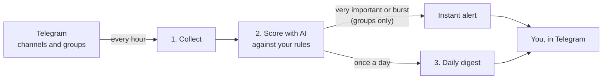

# How it works

**Audience:** operators who want to understand why the agent behaves the way it does, before tuning it.
Setting names (in `code`) are explained in [Configuration](configuration.md). The technical view is in the [architecture](../developer-guide/architecture.md).

## The life of a post

1. **Collect.** Every hour the agent reads new messages from your sources. The first time it sees a source, it reads the last 24 hours.
2. **Score.** Each post gets a score, a topic and a short reason from the AI model, judged against your rules in [`prompts/scoring.md`](../../prompts/scoring.md). Near-duplicates are recognized.
3. **Deliver.** Once a day the best posts become the digest. Alerts for groups go out sooner, within the hour.

A daily cleanup removes old posts, so storage stays small.

## Channels and groups

**Channels.** Every post is scored on its own.

**Groups** are noisy, so they are handled differently:

- If only a few messages arrived since the last run (up to `MaxItemsPerGroup`, 5 by default), each is a separate post.
- If there are more, messages are split by time into at most `MaxItemsPerGroup` bundles of similar size, and each bundle is scored with one AI call.
  The busier the group, the bigger the bundle, but the cost does not grow.
- Inside a bundle the messages with the most reactions, forwards and replies come first, so the key ones are not lost.
- The minimum length `MinPostChars` applies to single messages only. Short replies stay in a bundle, because their number shows a burst.

## Alerts

- Only for groups listed in `AlertSources`. Channels never trigger alerts.
- An alert is sent when a message or bundle scores at least `AlertThreshold` (9), or a bundle has at least `BurstMinPosts` (8) messages.
- One group triggers at most one alert per `AlertCooldownHours` (3), and one alert holds at most `AlertMaxPerRun` (3) entries.
- During `AlertQuietHours` (for example `23:00-07:00`) nothing is sent, and those posts go into the digest instead.
- A post that already triggered an alert is not repeated in the digest.

## The digest

After the best posts are chosen (`DigestSize`, 5 by default), one more AI call writes a short overview of the day and an explanation for every post,
using [`prompts/digest.md`](../../prompts/digest.md). The model never writes links: the agent adds them from the post data, so they cannot be invented.

If OpenAI is unavailable or its answer is invalid, the digest still arrives, without the summary and with the short scoring reasons.
The digest is always sent, even when nothing stood out.

## Data retention

Posts are kept for `RetentionDays` (1 by default: yesterday and today) and then deleted by day. The read position of each source is never deleted.
The digest can look back 48 hours only within the data that remains, so with the default it covers yesterday and today.

## Next

[Install it](installation.md), or see [Configuration](configuration.md) to change thresholds and schedules.
